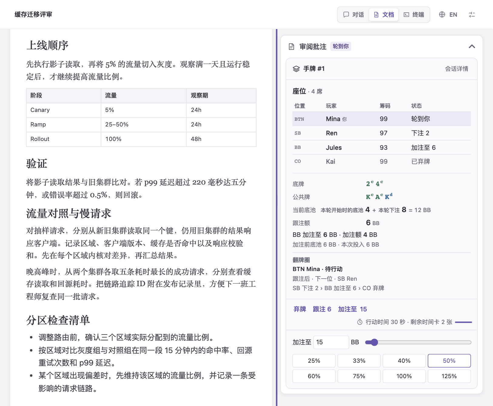

# 摸鱼德州 · Hold’em on the Clock

by [lrrong2020](https://github.com/lrrong2020)

[中文开桌指南](#中文) · [English quick start](#english) · [截图 / Screenshots](#screenshots)

上班时牌瘾来了，想找搭子单挑？朋友那边满屏都是测试日志，刚从终端加注到 6 BB。你还开着那份评审文档，在右边的批注栏点了跟注。两个人看着完全不同的屏幕，打的是同一手牌。摸鱼德州用虚拟筹码打无限注德州扑克，单挑到九人桌都行。搭子还没来？先跟电脑打两手。

Your friend raises to 6 BB from a terminal full of test results. You call from the margin of a document. Someone else at the table has a chat window open. You’re all playing the same hand. Hold’em on the Clock is a self-hosted, no-limit Texas Hold’em game for two to nine players, with play chips. There’s a computer opponent for the days nobody else can sneak in a hand.

## Screenshots

### 终端 · Terminal


左边循环播放 Git 变更和测试输出，右边轮到你行动。想看清某一行，随时可以暂停。

Git diffs and test results scroll by on the left. Play your hand on the right. You can pause the output mid-scroll.

### 对话 · Chat


把对话改个标题，再把问题和回答换成自己手头的项目。继续追问时，回复会根据已有笔记在浏览器里逐字显示。

Rename the thread and edit either side of the conversation to fit your project. Ask a follow-up and the reply appears a few words at a time, using the notes in that thread.

### 文档 · Document



侧栏里的每篇文档都能改名、用 Markdown 重写。正文往下滚，手牌留在批注栏。拖动分隔线就能给正文多留点地方，双击可以复位。用键盘时按左右键调宽。手机上分栏会上下排列。

Give any document a new title and write it in Markdown. Your cards stay in the margin as you scroll. Drag the divider for more writing room, or double-click it to reset. Arrow keys work too. On a phone, the panes stack.

## 中文

### 第一次开桌

只有开桌的人需要安装软件。朋友收到邀请后，用手机或电脑的浏览器就能入座。

1. 在开桌的电脑上安装 **Node.js 24 LTS**。Windows 选 `.msi` 安装包，macOS 选 `.pkg`。使用默认安装选项即可。[Node.js 下载页][node]
2. 下载游戏压缩包。[下载 ZIP][zip]
3. 解压 ZIP。Windows 右键选「全部解压」，macOS 双击压缩包。找到里面有 `package.json` 的文件夹。
4. 在这个文件夹中打开命令窗口。
   - **Windows** — 在文件资源管理器中打开该文件夹。点地址栏，输入 `cmd`，按回车。
   - **macOS** — 打开「终端」。输入 `cd`，再按一次空格。把该文件夹从 Finder 拖进终端，按回车。
   - **Linux** — 在文件管理器中打开该文件夹。从右键菜单选择「在终端中打开」。
5. 输入 `node --version` 并按回车。装好 Node.js 24 后，你会看到以 `v24.` 开头的版本号。

下面两种启动方式选一种。看到 Folio 后，就可以[发第一手牌](#发第一手牌)。

#### 自己玩，或和同一 Wi-Fi 的朋友玩

1. 在刚才的命令窗口运行下面这条命令。

   ```sh
   npm start
   ```

2. 等窗口显示 `Workspace available at http://localhost:4173`。开桌期间保留这个窗口。
3. 在这台电脑的浏览器打开 [本机牌桌](http://localhost:4173)。你会看到名为 **Folio** 的工作区。

#### 和不同网络的朋友玩

1. 在开桌的电脑上安装 `cloudflared`。
   - **Windows** — 在下载页选对应的 MSI 安装包，双击运行。[Cloudflare 下载页][cloudflared]
   - **macOS** — 从苹果菜单打开「关于本机」。根据芯片类型下载安装包，双击运行。[Apple 芯片][cf-arm] · [Intel 芯片][cf-intel]
   - **Linux** — 按发行版选择安装包，按下载页的说明安装。[Cloudflare 下载页][cloudflared]
2. 如果刚才运行了 `npm start`，先结束那桌牌，再在命令窗口按 **Ctrl+C**。停止服务会清除当前牌桌。
3. 在 `package.json` 所在文件夹打开新的命令窗口。运行 `cloudflared --version`。看到版本号后，运行下面这条命令。

   ```sh
   npm run start:online
   ```

4. 在浏览器打开 `Temporary HTTPS workspace:` 后面的完整网址。保持电脑唤醒、联网，命令窗口也要保持打开。下次启动时会得到新的网址。

#### 发第一手牌

1. 第一次打开 Folio 时，点右上角的 **中文**。
2. 点 **创建会话**。输入你的昵称。
3. 想先练一手，就保留 **单人练习**。要约朋友，就选 **和朋友一起**。
4. 点窗口底部的 **创建会话**。单人练习会直接发牌，你会看到自己的两张底牌。

和朋友开桌时，两人入座就能开打。

1. **房主**点 **邀请成员 → 复制链接**。把含 `/r/` 的完整链接发给朋友。
2. **朋友**打开链接。如果界面是英文，先点 **中文**。点 **申请入座**，输入昵称，再点 **提交申请**。
3. **房主**打开 **会话设置**。在朋友的昵称旁点 **批准**。至少两人入座后，点 **开始发牌**。

### 到你行动了

- **下注。** 默认买入 100 个大盲注（BB），小盲 0.5 BB，大盲 1 BB。轮到你时，加注滑杆已经展开，每档 0.5 BB。也可以直接输入金额，精确到 0.1 BB。点 **下注** 或 **加注至** 才会把筹码推到桌上。
- **看底池。** 截图里，翻牌前留下 4 BB。小盲下注 2 BB，大盲加注至 6 BB，加注额是 4 BB。翻牌圈两人共投入 8 BB，所以现在的底池是 12 BB。
- **翻牌谱。** 想找刚输的那一手？打开 **会话记录**，下拉列表里能看到自己的底牌、净盈亏和最终底池。用左右方向键逐手翻看，主池、边池和退回的未跟注筹码都在里面。
- **临时走开。** 行动时间用完会自动消耗时间卡。时间卡耗尽后，系统能过牌就过牌，否则弃牌。回来时点 **取消托管**。房主可以调整计时，也可以批准重新买入。

### 下次回来时

刷新后，用原来的浏览器和网址就能回座。所有人都掉线后有 30 秒可以重连。房间和牌谱存在开桌电脑的内存里。最后一位真人主动离桌，或房主停止服务，这桌牌就散了。牌谱保留自己的底牌，对手的底牌只有公开亮牌后才能看到。

你改过的对话和文档保存在浏览器里，按网址、房间和玩家区分。喜欢哪篇文档，可以把它设成新会话的模板。换设备、清除站点数据或换隧道域名后，旧副本不会跟过来。

单人练习用的是本地对手。想和云端模型打牌，房主可以打开 **会话设置 → Ollama Cloud**。密钥只在本场服务的内存中保存。模型只会收到自己的底牌和桌上公开的信息。

## English

### Set up your first table

Only the host needs to install software. Everyone else joins from a phone or computer with a browser.

1. On the host computer, install **Node.js 24 LTS**. On Windows, use the `.msi` installer. On macOS, use the `.pkg` installer. Keep the default settings. [Download Node.js][node]
2. Download the game. [Download ZIP][zip]
3. Extract the ZIP file. On Windows, right-click it and select **Extract All**. On macOS, double-click it. Find the folder that contains `package.json`.
4. Open a command window in that folder.
   - **Windows** — Open the folder in File Explorer. Type `cmd` in the address bar. Press Enter.
   - **macOS** — Open Terminal. Type `cd` followed by a space. Drag the folder from Finder into Terminal. Press Return.
   - **Linux** — Open the folder in your file manager. Select **Open in Terminal** from the right-click menu.
5. Run `node --version`. With Node.js 24 installed, you will see a version number that starts with `v24.`.

Choose one of the two ways below to start the table. When Folio opens, go to [Deal the first hand](#deal-the-first-hand).

#### Play solo or on the same Wi-Fi

1. In the command window, run this command.

   ```sh
   npm start
   ```

2. Wait for `Workspace available at http://localhost:4173`. Keep the command window open while you play.
3. On the host computer, open the [local table](http://localhost:4173) in your browser. The workspace is called **Folio**.

#### Play with friends on other networks

1. Install `cloudflared` on the host computer.
   - **Windows** — Run the MSI installer for your system. [Cloudflare downloads][cloudflared]
   - **macOS** — From the Apple menu, open **About This Mac**. Download the installer for your chip. Double-click it. [Apple silicon][cf-arm] · [Intel][cf-intel]
   - **Linux** — Follow the installation instructions for your distribution. [Cloudflare downloads][cloudflared]
2. If `npm start` is running, finish your game first. Press **Ctrl+C** in its command window. This closes the table.
3. Open a new command window in the folder that contains `package.json`. Run `cloudflared --version`. When you see a version number, run this command.

   ```sh
   npm run start:online
   ```

4. Open the full address after `Temporary HTTPS workspace:` in your browser. Keep the host computer awake and online. Leave the command window open. The address changes each time you start the tunnel.

#### Deal the first hand

1. In Folio, select **Create session**.
2. Enter your nickname.
3. For a practice hand, keep **Solo practice** selected. For a table with friends, select **With friends**.
4. Select **Create session** at the bottom of the window. In solo practice, you will see your two hole cards.

At a table with friends, one more player is enough to start.

1. As the **host**, select **Invite members**. Select **Copy link**. Send the full link to your friend. It contains `/r/`.
2. As the **guest**, open the link. Select **Request a seat**. Enter your nickname. Select **Send request**.
3. As the **host**, open **Session settings**. Select **Approve** next to your friend’s nickname. Once two players have seats, select **Start dealing**.

### Your turn

- **Bet sizing.** You sit down with 100 big blinds (BB). The blinds are 0.5/1 BB. The raise slider opens on your turn and moves 0.5 BB at a time. You can also type an amount to the nearest 0.1 BB. Your chips go in when you select **Bet** or **Raise to**.
- **Reading the pot.** In the screenshots, there are 4 BB in the pot when the flop comes down. The small blind bets 2 BB. The big blind raises to 6 BB, a raise of 4 BB. The two players put in 8 BB on the flop, bringing the pot to 12 BB.
- **Looking up a hand.** Want another look at the pot you just lost? Open **Session history**. Each entry shows your hole cards, net result and final pot. Use the arrow keys to move between hands. The replay shows the main pot, side pots and any uncalled bet that came back.
- **Stepping away.** Time cards kick in when your clock runs out. Once they’re gone, the table checks for you when it can and folds otherwise. Select **I'm back** to take over. The host can change the timer and approve rebuys.

### What happens when you leave?

Refresh in the same browser at the same address to get back to your seat. If everyone loses their connection, the table waits 30 seconds for someone to return. The host computer keeps rooms and hand histories in memory. The history clears when the last human player leaves or the host stops the server. You can review your hole cards. You can see an opponent’s cards only if they were shown.

Your edited chats and documents stay in your browser, with a separate copy for each room and player at that address. You can use a document as a template for future sessions. Those copies stay behind if you change devices or tunnel domains. Clearing site data removes them.

Solo practice uses a local opponent. To play against a cloud model, open **Session settings → Ollama Cloud** as the host. The server keeps the key in memory for that session. Each model sees its own hole cards and the public table information.

<details>
<summary>自定义部署 / Hosting options</summary>

已有 Node.js 20.3 或更高版本也可以启动游戏。默认端口是 `4173`，可用 `PORT` 更改。要限制为本机访问，可在运行 `npm start` 前设置 `HOST=127.0.0.1`。若已配置固定域名隧道，将它指向本机服务，并将 `PUBLIC_ORIGIN` 设为该域名的 HTTPS 地址。

The game runs on Node.js 20.3 or later. Set `PORT` to change the default port (`4173`). For local access only, set `HOST=127.0.0.1` before you run `npm start`. For a fixed domain, point your named tunnel at the local server. Set `PUBLIC_ORIGIN` to the HTTPS address for that domain.

</details>

## Tests

开发测试在项目文件夹里运行。 / Run the tests from the project folder.

```sh
npm ci
npm test
npx playwright install chromium webkit
npm run test:e2e
npm run test:webkit
```

## License

项目使用 Apache License 2.0。Markdown 解析器 Marked 使用 MIT 许可证。

The game uses Apache License 2.0. The bundled Markdown parser, Marked, uses the MIT license. [LICENSE](./LICENSE) · [NOTICE](./NOTICE) · [Marked notices](./public/vendor/marked-LICENSE.md)

[node]: https://nodejs.org/en/download
[zip]: https://github.com/lrrong2020/holdem-on-the-clock/archive/refs/heads/main.zip
[cf-arm]: https://github.com/cloudflare/cloudflared/releases/latest/download/cloudflared-arm64.pkg
[cf-intel]: https://github.com/cloudflare/cloudflared/releases/latest/download/cloudflared-amd64.pkg
[cloudflared]: https://developers.cloudflare.com/cloudflare-one/networks/connectors/cloudflare-tunnel/downloads/
