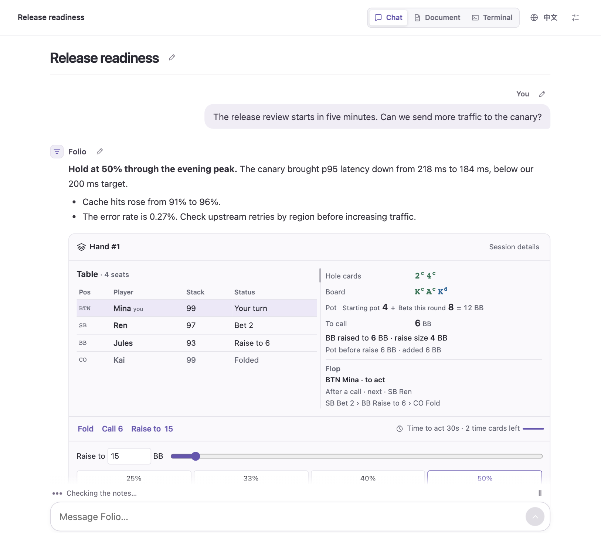
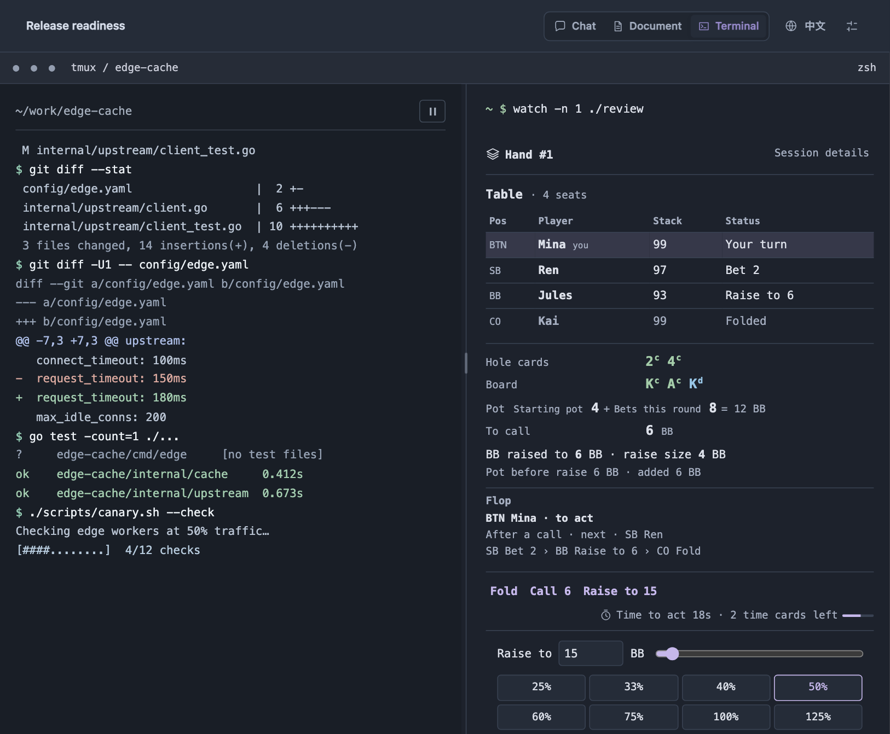

# 摸鱼德州 · Hold’em on the Clock

[中文](#中文) · [English](#english) · [截图 / Screenshots](#screenshots) · [测试 / Tests](#tests)

摸鱼德州是可自行开服的多人无限注德州扑克网页游戏，2–9 席，使用虚拟筹码。你可以在文档批注里跟注，朋友在终端里加注，两边看到的是同一手牌。

Hold’em on the Clock is a self-hosted multiplayer Texas Hold’em game for 2–9 seats, with no-limit betting and play chips. Call from a document margin while a friend raises from their terminal. Each player chooses a view and a language.

## Screenshots

### 对话 · Chat



每位玩家可以编辑对话标题、问题和回复。追问时，浏览器从当前对话中找出相关笔记，以打字动画显示回复。

Edit the thread title and either side of the conversation. Follow-up replies draw on the current notes and appear with a local typing animation.

### 文档 · Document


侧栏里的每份文档都可以改名、用 Markdown 重写。阅读长文时，手牌和下注控件留在右侧批注栏。拖动分隔线调宽，双击复位。

Rename any document in the sidebar and edit it in Markdown. Your cards and betting controls stay in the margin as you scroll. Drag the divider to resize it or double-click to reset it.

### 终端 · Terminal



终端回放 Git 差异、测试和发布检查，可随时暂停。桌面分栏支持拖动或用方向键调宽，手机上自动上下排列。

Pause or resume a local replay of Git diffs, tests and rollout checks. Desktop dividers support dragging and arrow keys. On narrow screens, the panes stack vertically.

## 中文

### 本机开桌

安装 **Node.js 20.3 或更高版本**，在项目目录中启动服务。

```sh
npm start
```

打开本机工作区，点 **创建会话** 并填写昵称。**单人练习** 会加入一位本地 AI 并发牌。选 **和朋友一起**，即可从 **邀请成员** 复制带 `/r/` 的房间链接。房主在 **会话设置** 批准入座，满两席后点 **开始发牌**。[打开 Folio](http://localhost:4173)

默认监听所有网卡的 `4173` 端口，可供同一局域网的朋友访问。可用 `PORT` 更改端口，或将 `HOST` 设为 `127.0.0.1` 仅供本机访问。

### 跨网络邀请

房主安装 `cloudflared` 后，用以下命令同时启动牌桌和临时 HTTPS 隧道。[安装 cloudflared](https://developers.cloudflare.com/tunnel/downloads/)

```sh
npm run start:online
```

打开终端输出的 HTTPS 地址建桌，再分享房间链接。主机需保持唤醒、联网。Ctrl+C 会关闭服务和隧道，重开隧道会换域名。已有固定域名时，可将命名隧道指向本机服务，并为 `npm start` 设置 `PUBLIC_ORIGIN`。[Cloudflare 临时隧道说明](https://developers.cloudflare.com/tunnel/get-started/quick-tunnels/)

### 下注与复盘

- 默认买入 100 BB，盲注 0.5/1 BB。加注控件默认展开，滑杆每档 0.5 BB，手动输入精确到 0.1 BB。选好金额后点 **下注** 或 **加注至** 才会提交。
- 底池分列本轮起始底池、当轮下注与当前总额。上图中，小盲下注 2 BB，大盲加注至 6 BB，加注额为 4 BB。本轮共投入 8 BB，原有的 4 BB 底池变为 12 BB。
- **会话记录** 可按自己的底牌、净盈亏和最终底池定位牌谱。用上一手、下一手或左右方向键查看各轮行动、主池、边池及退回的未跟注筹码。
- 房主可调整行动时间、时间卡并审批重新买入。超时后自动逐张使用时间卡，耗尽后托管会过牌或弃牌。点 **取消托管** 可恢复手动行动。

### 数据与会话

Node.js 服务负责发牌、验证行动和结算，房间和牌谱保存在服务器内存。原浏览器在同一域名下刷新可以凭 Cookie 回座。最后一位真人主动离桌时立即散桌。全部真人断线后有 30 秒重连时间，重启服务会清除所有房间。对手底牌仅在公开亮牌后可见。

个人对话和文档保存在浏览器中，按站点、房间和玩家区分。文档可设为本浏览器的新会话模板。换设备、清除站点数据或更换隧道域名会影响本地内容和座位恢复。

房主可在 **会话设置 → Ollama Cloud** 添加云端 AI 对手。本场密钥仅留在服务器内存。模型决策时只收到该对手的底牌和公开局面。工作区聊天回复由浏览器在本地生成。

## English

### Start a local table

Install **Node.js 20.3 or later**. Run the server from the project directory.

```sh
npm start
```

Open Folio, select **Create session** and enter a nickname. **Solo practice** deals against a local AI opponent. To host a game, select **With friends** and share the `/r/` link from **Invite members**. Approve seat requests in **Session settings** and choose **Start dealing** once two seats are occupied. [Open Folio](http://localhost:4173)

The server listens on port `4173` on all interfaces for LAN play. Set `PORT` to change the port, or `HOST` to `127.0.0.1` for local-only access.

### Invite friends over HTTPS

Install `cloudflared` on the host, then start the table and a temporary HTTPS tunnel together. [Install cloudflared](https://developers.cloudflare.com/tunnel/downloads/)

```sh
npm run start:online
```

Open the printed HTTPS address, create a session and share the room link. Keep the host awake and online. Ctrl+C stops the service and tunnel. Restarting the tunnel changes the hostname. For a fixed domain, point a named tunnel at the local server and set `PUBLIC_ORIGIN` to its HTTPS origin when running `npm start`. [Cloudflare Quick Tunnels](https://developers.cloudflare.com/tunnel/get-started/quick-tunnels/)

### Betting and hand history

- The buy-in is 100 BB with 0.5/1 BB blinds. Raise controls open on your turn. Use a pot-size preset, move the slider in 0.5 BB steps or enter a target to the nearest 0.1 BB. Confirm with **Bet** or **Raise to**.
- The pot display separates earlier chips from this round’s bets. In the screenshots, the small blind bets 2 BB and the big blind raises to 6 BB, a raise of 4 BB. The 8 BB wagered on the flop brings the starting pot of 4 BB to 12 BB.
- **Session history** lists your hole cards, net result and final pot for each hand. Use the previous and next buttons or the arrow keys to review the action by street, main and side pots, and uncalled bets.
- Hosts set the action timer and time cards and approve rebuys. Time cards activate automatically. Once they run out, the table checks when possible and otherwise folds. Choose **I’m back** to resume manual play.

### Data and session lifetime

The Node.js server deals cards, validates actions and settles pots. Rooms and hand histories live in server memory. A session cookie restores your seat in the same browser on the same domain. The table closes when the last human player leaves. If everyone disconnects, there is a 30-second reconnect window. Restarting the server clears every room. Opponents’ hole cards are visible only when revealed.

Personal chat and documents stay in the browser, scoped to the site, room and player. A document can also serve as the template for new sessions in that browser. Changing devices or tunnel domains, or clearing site data, affects access to local copies and seats.

Hosts can add optional cloud AI opponents under **Session settings → Ollama Cloud**. The session key stays in server memory. Each model receives its own hole cards and public table information. Workspace chat replies are generated locally.

## Tests

```sh
npm ci
npm test
npx playwright install chromium webkit
npm run test:e2e
npm run test:webkit
```

## License

项目代码采用 Apache License 2.0。内置的 Markdown 解析器 Marked 使用 MIT 许可证，并附上游声明。

Project code is licensed under Apache License 2.0. The bundled Markdown parser, Marked, is distributed under MIT with its upstream notices. [LICENSE](./LICENSE) · [NOTICE](./NOTICE) · [Marked license and notices](./public/vendor/marked-LICENSE.md)
